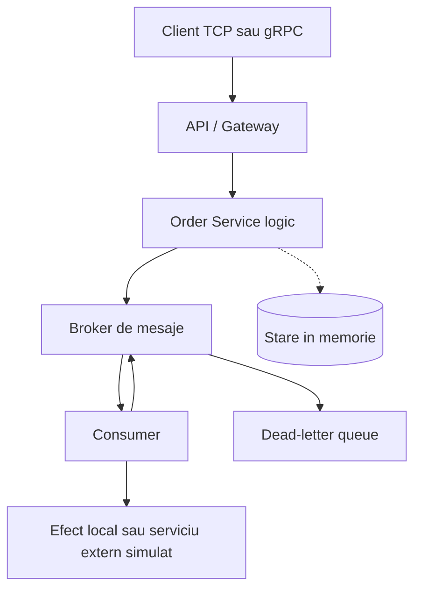

# Mesagerie fiabila in Python

Acesta este primul increment al proiectului: flux producer-broker-consumer cu garantii explicite si limite documentate.

## Repository si livrabile

Repository-ul proiectului este:

https://github.com/StanislavProdan/PAD

Livrabilele arhitecturale sunt organizate astfel:

- diagrama: [docs/architecture.md](docs/architecture.md);
- decizia arhitecturala: [docs/adr/001-messaging-boundary.md](docs/adr/001-messaging-boundary.md);
- dovada scenariului de esec: [docs/failure-scenario.md](docs/failure-scenario.md);
- incrementul 1: tag-ul `lab1-v1.0`;
- incrementul 2: tag-ul `lab2-v1.0`.

## Structura proiectului

Fișierele din rădăcină sunt împărțite pe roluri:

| Zonă | Fișiere | Rol |
| --- | --- | --- |
| Nucleu și transport TCP | `reliable_messaging.py` | Brokerul, producerul, consumerul, DLQ și protocolul TCP/JSON |
| Contract și transport gRPC | `reliable_messaging.proto`, `grpc_service.py` | Contractul versionat și implementarea serviciului gRPC |
| Binding-uri generate | `reliable_messaging_pb2.py`, `reliable_messaging_pb2_grpc.py` | Cod generat din contractul `.proto`; este urmărit intenționat pentru rulare fără `protoc` |
| Exemple | `demo_grpc.py` | Demonstrație minimală client-server gRPC |
| Testare | `test_reliable_messaging.py`, `test_grpc_service.py`, `manual_test.py` | Teste automate și scenarii interactive |
| Comenzi Windows | `mesaje.bat`, `manual.bat`, `teste.bat` | Scurtături pentru rularea demo-ului, testării manuale și testelor |
| Documentație | `docs/`, `README.md` | Arhitectură, decizii și scenarii explicate |

`.venv/` și `__pycache__/` sunt artefacte locale generate automat și nu fac parte
din proiect; sunt ignorate de Git.

## Diagrama arhitecturii



Diagrama completă și delimitarea responsabilităților pe increment se află în
[docs/architecture.md](docs/architecture.md).

## Cerința minimă: sender, broker și receiver

Implementarea TCP respectă cerința minimă în care există trei componente:
`sender`, `broker` și `receiver`. Traseul unui mesaj este:

```text
sender -> TCPForwardingBrokerServer -> TCPReceiverServer
```

### Rolurile componentelor

- **Senderul** este reprezentat de funcția `send_message()`. El construiește
  mesajul JSON, care conține `message_id`, `message_type` și `payload`, și îl
  trimite brokerului prin TCP.
- **Brokerul** este reprezentat de `TCPForwardingBrokerServer`. Adresa
  receiverului este cunoscută de broker din momentul pornirii, prin parametrul
  `receiver_address`. Pentru fiecare mesaj primit, brokerul validează datele și
  alege receiverul configurat.
- **Receiverul** este reprezentat de `TCPReceiverServer`. El primește mesajul
  redirecționat și aplică efectul definit de funcția `effect`.

Brokerul nu implementează un mecanism de subscription și nu păstrează o coadă
de mesaje pentru acest traseu. După validare, el apelează imediat receiverul
prin `send_tcp_request()`, apoi returnează senderului confirmarea
`{"ok": true, "status": "forwarded"}`. Astfel, brokerul are doar
responsabilitatea de a redirecționa mesajul.

Atât brokerul, cât și receiverul folosesc `ThreadingTCPServer`. Prin urmare,
conexiunile independente sunt gestionate în thread-uri separate și cererile
pot fi procesate concurent, fără ca o conexiune să blocheze acceptarea altor
cereri.

Această implementare minimală este separată de `Broker`, `Consumer` și
`TCPBrokerServer`, care oferă funcționalități suplimentare precum FIFO,
ACK/NACK, retry, redelivery, deduplicare și dead-letter queue. Aceste
funcționalități nu sunt necesare pentru cerința minimă sender–broker–receiver,
dar sunt păstrate pentru demonstrațiile de mesagerie fiabilă.

## Rulare

```powershell
python -m unittest -v
python reliable_messaging.py
python reliable_messaging.py --interactive
python reliable_messaging.py --server 127.0.0.1 9000
python reliable_messaging.py --client 127.0.0.1 9000
python reliable_messaging.py --menu
python manual_test.py
```

Cu `--interactive`, scrii mesajele tale în consolă. O linie goală încheie introducerea și consumerul procesează mesajele prin broker.

## Rulare client-server prin TCP

Pornește serverul într-un terminal:

```powershell
python reliable_messaging.py --server 127.0.0.1 9000
```

În alt terminal pornește clientul:

```powershell
python reliable_messaging.py --client 127.0.0.1 9000
```

Serverul deține brokerul și consumerul. Clientul trimite comenzi JSON delimitate
cu newline, iar serverul răspunde tot cu JSON. Pentru fiecare mesaj publicat,
serverul aplică efectul local și trimite răspunsul `status: "acked"`.
Protocolul suportă și comenzile `status`, `events` și `shutdown`. Payload-ul
trebuie să fie serializabil JSON. Livrarea rămâne at-least-once în memoria
procesului; oprirea serverului pierde coada și identificatorii de deduplicare.

Pentru utilizare fără argumente repetate, pornește meniul:

```powershell
python reliable_messaging.py --menu
```

Meniul permite selectarea serverului local, adăugarea unui server cu host și
port personalizate, pornirea serverului, conectarea clientului și afișarea
statusului sau a evenimentelor. Serverele adăugate sunt memorate doar în
sesiunea curentă a meniului.

## Increment gRPC: contract versionat și rezultat ambiguu
Laboratorul implementează un serviciu gRPC pentru publicarea mesajelor. Scopul principal este ca mesajele să nu fie procesate de două ori și ca o operație să poată fi verificată chiar dacă răspunsul inițial se pierde.
Incrementul gRPC este implementat separat în `grpc_service.py`, iar contractul
explicit se află în `reliable_messaging.proto`. Binding-urile Python generate
(`reliable_messaging_pb2.py` și `reliable_messaging_pb2_grpc.py`) sunt incluse
pentru ca aplicația să poată porni fără `protoc` instalat local.
Implementarea oferă un contract gRPC versionat, publicare idempotentă prin request_id, identificarea mesajului prin message_id și un mecanism de fallback prin GetOperationStatus. În cazul unui timeout, clientul nu repetă efectul, ci verifică starea operației. Testele verifică idempotency, timeout-ul cu status fallback și respingerea versiunilor incompatibile.

Pe scurt, clientul comunică cu serverul prin metodele gRPC `Publish` și
`GetOperationStatus`, definite în fișierul `.proto`. Folosirea aceluiași
`request_id` previne procesarea duplicată a unui mesaj. Dacă apare un timeout,
clientul verifică starea operației fără să repete efectul. Pentru rulare sunt
necesare librăriile `grpcio` și `grpcio-tools`, instalabile cu:

```powershell
.\.venv\Scripts\python.exe -m pip install -e .
```

Demonstrația client-server poate fi rulată cu:

```powershell
.\.venv\Scripts\python.exe demo_grpc.py
```

Contractul `reliable.messaging.v1` expune:

- `Publish`, cu `contract_version`, `request_id` (cheie de idempotency) și
  `payload`;
- `GetOperationStatus`, fallback-ul sigur pentru rezolvarea unei operații;
- `Outcome`, care poate fi `APPLIED`, `NOT_APPLIED` sau `AMBIGUOUS`.

Clientul transmite deadline-ul prin timeout-ul gRPC. Dacă deadline-ul expiră
sau apelul este anulat, `GrpcMessagingClient.publish()` nu repetă efectul:
interoghează `GetOperationStatus` folosind același `request_id`. Astfel, dacă
serverul a aplicat efectul dar răspunsul s-a pierdut, clientul primește
`APPLIED` și același `message_id`; un retry cu aceeași cheie rămâne idempotent.
Un `request_id` necunoscut este raportat ca `NOT_APPLIED`, iar versiunile de
contract necunoscute sunt respinse cu `UNIMPLEMENTED`.

Exemplu minimal:

```python
from grpc_service import GrpcMessagingClient, GrpcMessagingServer

server = GrpcMessagingServer()
server.start()
client = GrpcMessagingClient(f"127.0.0.1:{server.address}", timeout=2)
try:
    response = client.publish("order-created", request_id="order-1")
    print(response.outcome, response.message_id)
finally:
    client.close()
    server.stop()
```

Testele incrementului se rulează cu:

```powershell
.\.venv\Scripts\python.exe -m unittest -v test_grpc_service.py
```

## Conformitatea cu obiectivele proiectului

Implementarea actuală respectă obiectivele principale ale celor două
incrementuri livrate. Componentele sunt separate pe roluri, au protocoale
explicite și sunt acoperite de teste automate.

### Incrementul 1: sender, broker și receiver

Fluxul TCP implementat este:

```text
sender -> TCPForwardingBrokerServer -> TCPReceiverServer -> efect
```

Sunt respectate următoarele obiective:

- **Protocol de comunicare definit:** mesajele sunt transmise prin TCP,
  folosind JSON delimitat prin newline. Fiecare mesaj poate conține
  `message_id`, `message_type` și `payload`.
- **Comunicare între emițător, agent și receptor:** senderul trimite mesajul
  brokerului, iar brokerul îl transmite receiverului configurat.
- **Primirea și transmiterea mesajelor:** brokerul primește, validează și
  redirecționează mesajul imediat, fără să aștepte procesări suplimentare.
- **Adresă cunoscută a receiverului:** brokerul primește
  `receiver_address` la pornire și poate avea rute suplimentare în dicționarul
  `routes`.
- **Rutare:** valoarea `message_type` poate selecta receiverul potrivit.
  Dacă nu există o rută specială, se folosește receiverul implicit.
- **Unicast:** un mesaj este transmis către receiverul selectat prin adresa și
  portul acestuia.
- **Procesare concurentă:** brokerul și receiverul folosesc
  `ThreadingTCPServer`, astfel conexiunile independente pot fi procesate în
  thread-uri separate.
- **Separarea responsabilităților:** brokerul are rolul de a valida și
  redirecționa mesajul, iar receiverul aplică efectul asupra payload-ului.
- **Testare:** testul `test_socket_sender_broker_receiver_routes_json_message`
  verifică traseul complet sender–broker–receiver și rutarea unui mesaj.

Pentru acest traseu minimal, brokerul nu are mecanism de subscription și nu
păstrează o coadă de mesaje. Receiverul păstrează mesajele primite în memorie
în `TCPReceiverServer.messages`, în principal pentru inspectare și testare.

### Incrementul 2: contract gRPC și operații idempotente

Fluxul gRPC implementat este:

```text
gRPC client -> ReliableMessagingServicer -> operation store
```

Sunt respectate următoarele obiective:

- **Protocol și contract explicit:** serviciul este definit în
  `reliable_messaging.proto`, iar mesajele și metodele sunt generate prin
  binding-uri protobuf.
- **Contract versionat:** fiecare cerere conține `contract_version`, iar
  serverul acceptă versiunea `v1` și respinge versiunile necunoscute cu
  `UNIMPLEMENTED`.
- **Identificarea operațiilor:** `request_id` identifică unic o cerere și este
  folosit pentru idempotency.
- **Identificarea mesajelor:** fiecare operație primește un `message_id`
  stabil, reutilizat la apelurile repetate cu același `request_id`.
- **Prevenirea duplicatelor:** aceeași operație nu aplică efectul de două ori,
  chiar dacă clientul repetă cererea.
- **Procesare concurentă:** serverul gRPC folosește un
  `ThreadPoolExecutor` cu mai mulți workeri.
- **Rezultat explicit:** operațiile pot avea rezultatul `APPLIED`,
  `NOT_APPLIED` sau `AMBIGUOUS`, însoțit de o explicație în `detail`.
- **Tratarea timeout-urilor:** dacă răspunsul `Publish` expiră, clientul nu
  repetă efectul, ci apelează `GetOperationStatus` cu același `request_id`.
- **Verificarea rezultatului:** `GetOperationStatus` permite determinarea
  rezultatului unei operații chiar dacă răspunsul inițial nu a ajuns la client.
- **Validarea intrărilor:** serverul verifică versiunea contractului și
  existența lui `request_id`.
- **Testare:** testele gRPC verifică idempotency, fallback-ul după timeout și
  respingerea unei versiuni incompatibile.

### Cerințe generale și limite asumate

| Obiectiv | Status | Explicație |
|---|---|---|
| Comunicare TCP/IP | ✅ Respectat | Incrementul 1 folosește socket-uri TCP. |
| Comunicare distribuită client–server | ✅ Respectat | Există componente de rețea separate pentru sender, broker, receiver și clientul gRPC. |
| Rutarea mesajelor | ✅ Respectat | Brokerul rutează după `message_type` și `routes`. |
| Comunicare unicast | ✅ Respectat | Mesajele sunt transmise către un receiver configurat. |
| Procesare concurentă | ✅ Respectat | TCP folosește `ThreadingTCPServer`, iar gRPC folosește thread pool. |
| Păstrarea mesajelor în timpul execuției | ✅ Parțial respectat | Mesajele și operațiile sunt păstrate în memoria procesului. |
| Persistență după repornire | ⚠️ Limitare | Nu există încă bază de date sau stocare permanentă. |
| XML și validarea datelor XML | ⚠️ Limitare | Protocolul actual folosește JSON/protobuf; XML și XSD nu sunt incluse în aceste incrementuri. |
| UDP multicast | ⚠️ Limitare | Este implementat unicast TCP; multicastul nu este inclus în traseele actuale. |
| Integrarea gRPC cu brokerul TCP | ⚠️ Limitare | Incrementul 2 este un traseu gRPC separat; integrarea este o extindere ulterioară. |
| Subscription la broker | ✅ Ne-necesar pentru cerința minimă | Brokerul cunoaște dinainte receiverul și redirecționează direct mesajul. |

Prin urmare, proiectul respectă cerința minimă sender–broker–receiver și
incrementul 2 gRPC, inclusiv rutarea, comunicarea distribuită, procesarea
concurentă, contractul versionat și idempotency. XML, UDP multicast,
persistența permanentă și integrarea dintre cele două trasee sunt documentate
explicit ca funcționalități care nu fac parte din incrementurile actuale.


În meniul manual poți alege mesaj normal, mesaj duplicat, crash după efect înainte de ACK, eroare cu retry și DLQ, ordering pentru trei mesaje, afișarea stării brokerului sau istoricul complet al evenimentelor din sesiune.


### ACK și scenariul de crash


Verifică faptul că efectul este aplicat o singură dată, mesajul este redelivrat și apoi confirmat cu ACK.

### NACK, retry și dead-letter queue


Verifică faptul că mesajul este retrimis, iar după `max_attempts` ajunge în `broker.dead_letters`.

### Deduplicare


Verifică faptul că două mesaje cu același `message_id` produc un singur efect local.

### Ordering


Verifică procesarea în ordinea `first`, `second`, `third`.

### Eșecul efectului local


Verifică faptul că o excepție a consumerului produce NACK, retry și în final DLQ.

## Conceptele implementate

### 1. Contract de mesaj

Este definit de clasa `Message` din `reliable_messaging.py`:

- `message_id` identifica unic mesajul si este folosit pentru deduplicare;
- `sequence` indica ordinea publicarii;
- `payload` contine datele efective ale mesajului;
- `attempts` retine numarul de livrari incercate.

`Producer.send()` construieste mesajul prin `Broker.publish()`. Astfel producerul si consumerul folosesc aceeasi structura, nu transfera valori anonime.

### 2. ACK

ACK inseamna ca mesajul a fost procesat cu succes. In `Consumer.process_one()`, efectul local este executat mai intai, iar apoi se apeleaza `broker.ack(message.message_id)`.

Brokerul elimina mesajul din dictionarul `in_flight` numai dupa ACK. Daca procesul se opreste inainte de acest punct, mesajul poate fi livrat din nou.

### 3. NACK

NACK inseamna ca mesajul nu a putut fi procesat. La o exceptie a efectului local, consumerul apeleaza automat `broker.nack()`. NACK poate fi solicitat si explicit prin `Consumer.reject_current()`.

Brokerul scoate mesajul din `in_flight` si il pune inapoi in coada pentru o noua incercare. Daca a fost atins `max_attempts`, nu il mai retrimite si il muta in DLQ.

### 4. Retry

Retry-ul este implementat in `Broker.nack()`. Mesajul este reintrodus cu `appendleft()`, iar la urmatoarea livrare campul `attempts` este incrementat.

Exemplu: cu `max_attempts=3`, acelasi mesaj poate fi livrat de cel mult trei ori. Dupa a treia esuare ajunge in dead-letter queue.

### 5. Deduplicare

Consumerul pastreaza identificatorii mesajelor procesate in `processed_ids`. La redelivery, daca `message_id` exista deja in aceasta colectie, efectul local nu mai este executat, dar mesajul este confirmat cu ACK.

Aceasta rezolva scenariul in care efectul a reusit, dar ACK-ul s-a pierdut. In implementarea actuala setul este in memorie; pentru productie ar trebui persistat impreuna cu efectul local.

### 6. Ordering

Brokerul foloseste `deque`, iar mesajele noi sunt adaugate la coada cu `append()`. `sequence` este incrementata la fiecare publicare, iar un consumer proceseaza mesajele in ordinea FIFO.

Un retry este pus in fata cozii cu `appendleft()`, pentru ca mesajul esuat sa fie rezolvat inaintea urmatorului mesaj. Garantia este valabila pentru un consumer activ; mai multi workeri ar necesita reguli suplimentare de partitionare si ordering.

### 7. Dead-letter queue

DLQ este lista `broker.dead_letters`. Cand un mesaj esueaza dupa `max_attempts`, `Broker.nack()` sau `Broker.recover_unacked()` il muta acolo in loc sa il mai livreze.

DLQ permite izolarea mesajelor problematice pentru investigare, fara blocarea permanenta a cozii principale. In acest prototip este in memorie si se pierde la oprirea procesului.

## Scenariul critic: crash dupa efect, inainte de ACK

Scenariul este simulat de `consumer.process_one(crash_after_effect=True)`:

1. brokerul livreaza mesajul si il pune in `in_flight`;
2. consumerul aplica efectul local si il adauga in `processed_ids`;
3. consumerul se opreste inainte de ACK si mesajul ramane in `in_flight`;
4. `broker.recover_unacked()` il reintroduce in coada;
5. la redelivery, consumerul vede acelasi `message_id`, nu repeta efectul si trimite ACK.

Testul `test_crash_after_effect_redelivers_without_duplicate_effect` verifica exact acest flux.

## Garantii si limite

Implementarea ofera livrare **at-least-once** si ordonare FIFO pentru un consumer activ. Deduplicarea este in memoria procesului; intr-un sistem real, `processed_ids` si efectele trebuie pastrate intr-o baza de date tranzactionala sau intr-un store durabil. Fara o tranzactie comuna intre efect si ACK, nu se poate obtine exact-once end-to-end doar din broker.

`recover_unacked()` modeleaza expirarea lease-ului dupa caderea consumerului. In productie, aceasta ar fi declansata de timeout si ar necesita persistenta, autentificare, observabilitate si mai multi workeri cu reguli explicite de ordering.