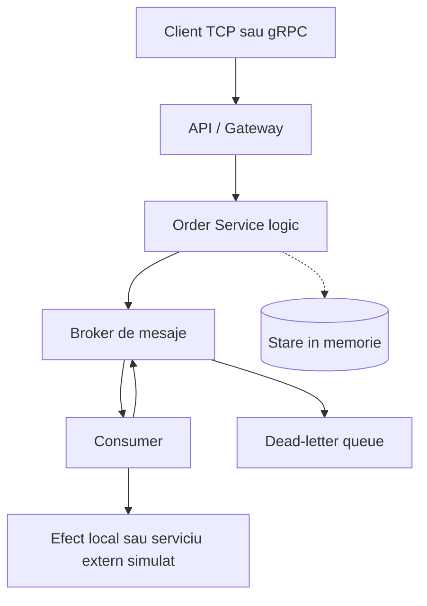

# Diagrama arhitecturii

## Arhitectura livrata in primele doua incremente



In implementarea actuala, serverul TCP si serviciul gRPC reprezinta suprafetele
de intrare. Brokerul, consumerul si starea de deduplicare sunt componente in
memorie. `Order Service logic` este reprezentat de orchestration-ul de
publicare, nu de un proces separat inca.

## Trasee implementate

### Incrementul 1

```text
TCP client -> TCPBrokerServer -> Producer -> Broker -> Consumer -> efect
```

Brokerul asigura FIFO, ACK/NACK, retry, redelivery, deduplicare si DLQ.

### Incrementul 2

```text
gRPC client -> ReliableMessagingServicer -> operation store in memorie
```

Serviciul gRPC adauga contract versionat, `request_id`, `message_id` si
`GetOperationStatus` pentru rezolvarea unui timeout. Acest traseu nu publica
inca in brokerul din incrementul 1; integrarea dintre API, serviciul de comenzi
si broker este o extindere ulterioara.

## Limite asumate

- persistenta bazei de date nu este inclusa in aceste incremente;
- brokerul si deduplicarea se pierd la oprirea procesului;
- exista un singur consumer activ;
- serviciul extern este modelat printr-o functie de efect;
- garantarea este at-least-once, nu exact-once end-to-end.
